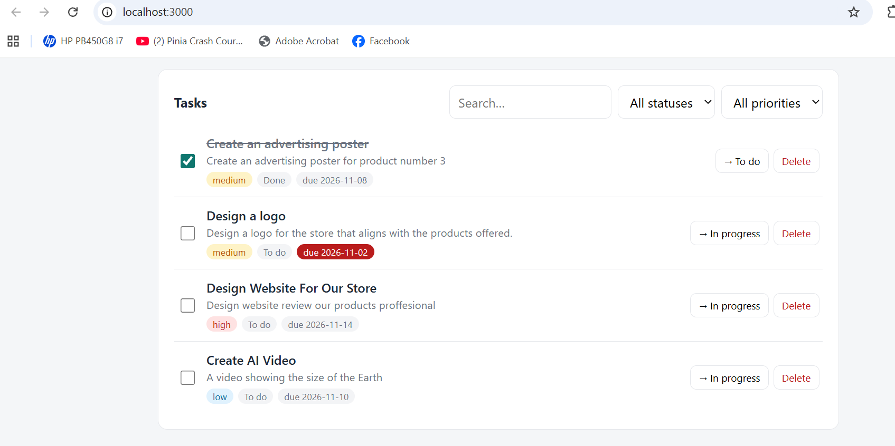
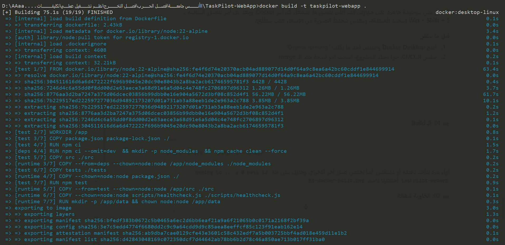
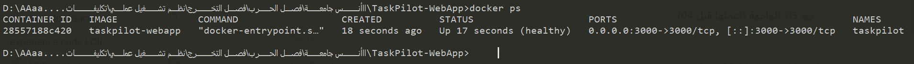
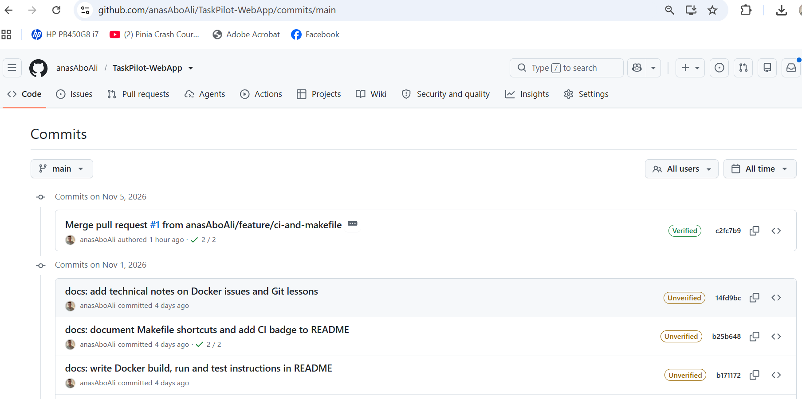

# TaskPilot-WebApp


**TaskPilot** is a lightweight task-management web application: a REST API plus a clean web UI to create, filter, search, track and complete tasks. It is written in **pure Node.js (zero runtime dependencies)** and packaged to run anywhere with **Docker** in one command.



---

## Features

- Create tasks with title, description, priority (`low` / `medium` / `high`) and due date
- Move tasks through statuses: `todo` → `in_progress` → `done`
- Filter by status and priority, and full-text search
- Live dashboard: totals per status and **overdue** counter
- Input validation with clear error messages (`422`)
- Data persisted to a JSON file stored in a **Docker volume** (survives container restarts)
- `/health` endpoint used by the Docker **HEALTHCHECK**
- Graceful shutdown on `SIGTERM` (`docker stop`)
- Automated tests (Node's built-in test runner) that run **inside the Docker build**

## Tech Stack

| Layer | Technology |
|---|---|
| Runtime | Node.js 22 (built-in `http`, `fs`, `crypto` modules) |
| Frontend | HTML, CSS, vanilla JavaScript (served by the same server) |
| Storage | JSON file with atomic writes (`/app/data/tasks.json`) |
| Tests | `node:test` + `fetch` |
| Containers | Docker (multi-stage build), Docker Compose |
| CI | GitHub Actions (tests + Docker build + smoke test) |

## Project Structure

```
TaskPilot-WebApp/
├── src/
│   ├── server.js            # entry point (starts HTTP server, graceful shutdown)
│   ├── app.js               # routes & request handling
│   ├── http.js              # tiny router + JSON helpers
│   ├── validation.js        # input validation
│   ├── config.js            # environment configuration
│   ├── store/taskStore.js   # JSON-file persistence
│   └── public/              # web UI (index.html, app.js, styles.css)
├── tests/api.test.js        # API & UI tests
├── scripts/healthcheck.js   # used by Docker HEALTHCHECK
├── .github/workflows/       # CI pipeline
├── docs/
│   ├── screenshots/         # assignment screenshots
│   └── notes.md             # technical notes
├── Dockerfile
├── docker-compose.yml
├── Makefile
├── .dockerignore
├── .gitignore
├── .env.example
└── LICENSE
```

---

## Quick Start (Docker)

**Prerequisites:** [Docker](https://docs.docker.com/get-docker/) installed and running. Nothing else (no Node.js needed).

### 1. Clone the repository

```bash
git clone https://github.com/anasAboAli/TaskPilot-WebApp.git
cd TaskPilot-WebApp
```

### 2. Build the image

```bash
docker build -t taskpilot-webapp .
```

> The build runs the test suite. If any test fails, the build fails.

### 3. Run the container

```bash
docker run -d --name taskpilot -p 3000:3000 -v taskpilot-data:/app/data taskpilot-webapp
```

Open **http://localhost:3000** 🎉

### 4. Check it is running

```bash
docker ps                      # STATUS should become "Up ... (healthy)"
docker logs taskpilot          # view request logs
```

### 5. Stop and clean up

```bash
docker stop taskpilot          # stop the container (graceful shutdown)
docker rm taskpilot            # remove the container
docker rmi taskpilot-webapp    # (optional) remove the image
docker volume rm taskpilot-data  # (optional) delete saved tasks
```

---

## Option B — Docker Compose (one command)

```bash
docker compose up -d --build   # build & start
docker compose ps              # status (healthy)
docker compose logs -f         # logs
docker compose down            # stop & remove container
docker compose down -v         # ...and delete the data volume
```

## Option C — Makefile shortcuts

```bash
make help     # list all commands
make build    # build the image
make run      # run on http://localhost:3000
make health   # show container health status
make logs     # follow logs
make stop     # stop & remove the container
make test     # run tests inside Docker
make clean    # remove container, image and volume
```

> On Windows, `make` is available through Git Bash/WSL — or just use the Docker commands above.

---

## Configuration

| Variable | Default | Description |
|---|---|---|
| `PORT` | `3000` | Port the server listens on inside the container |
| `HOST` | `0.0.0.0` | Interface to bind (must be `0.0.0.0` inside Docker) |
| `DATA_DIR` | `/app/data` | Folder where `tasks.json` is stored |
| `HOST_PORT` | `3000` | (Compose only) port published on your machine |

No secrets or environment values are required. If port 3000 is busy on your machine, map another one:

```bash
docker run -d --name taskpilot -p 8080:3000 taskpilot-webapp   # → http://localhost:8080
# or with Compose:
HOST_PORT=8080 docker compose up -d
```

---

## How to Test

### In the browser
1. Open http://localhost:3000
2. Add a task (e.g. *"Prepare presentation"*, priority **High**, due date tomorrow)
3. Click **→ In progress**, then tick the checkbox to mark it **Done**
4. Use the search box and filters; watch the counters update
5. Restart the container (`docker restart taskpilot`) — your tasks are still there

### With the API (curl)

```bash
# Health
curl http://localhost:3000/health

# Create a task
curl -X POST http://localhost:3000/api/tasks \
  -H "Content-Type: application/json" \
  -d '{"title":"Submit OS assignment","priority":"high","dueDate":"2026-12-31"}'

# List tasks (with optional filters)
curl "http://localhost:3000/api/tasks?status=todo&priority=high&q=assignment"

# Update a task status (replace <id>)
curl -X PATCH http://localhost:3000/api/tasks/<id> \
  -H "Content-Type: application/json" -d '{"status":"done"}'

# Statistics
curl http://localhost:3000/api/stats

# Delete
curl -X DELETE http://localhost:3000/api/tasks/<id>
```

### API reference

| Method | Endpoint | Description | Success |
|---|---|---|---|
| GET | `/health` | Health status, version, uptime | 200 |
| GET | `/api/tasks` | List tasks (`?status=`, `?priority=`, `?q=`) | 200 |
| POST | `/api/tasks` | Create a task | 201 |
| GET | `/api/tasks/:id` | Get one task | 200 |
| PATCH | `/api/tasks/:id` | Update fields of a task | 200 |
| DELETE | `/api/tasks/:id` | Delete a task | 204 |
| GET | `/api/stats` | Counts by status/priority + overdue | 200 |

Errors return JSON: `400` invalid JSON, `404` not found, `405` wrong method, `422` validation errors.

### Automated tests

```bash
make test                 # inside Docker
# or locally (Node.js 20+):
npm test
```

---

## Docker Design Notes

- **Multi-stage build:** `test` (runs tests) → `deps` (production deps only) → `runtime` (final small image). The runtime stage copies the source *from the test stage*, so tests always run before an image is produced.
- **Small base image:** `node:22-alpine`.
- **Security:** runs as the non-root `node` user.
- **Layer caching:** `package*.json` is copied before the source code.
- **HEALTHCHECK** uses a Node script (no `curl`/`wget` needed in the image).
- **Exec-form `CMD`:** Node runs as PID 1 and receives `SIGTERM` for a graceful shutdown.
- **`.dockerignore`** keeps `node_modules`, `.git`, local data and docs out of the build context.

More details and lessons learned: [docs/notes.md](docs/notes.md).

## Screenshots

| Docker build | Container running | App UI | Commit history |
|---|---|---|---|
|  |  |  |  |

## Attribution

This project was designed and written from scratch for the OS Lab assignment (Docker & GitHub). It is not based on an existing open-source project.

## License

Released under the [MIT License](LICENSE).
